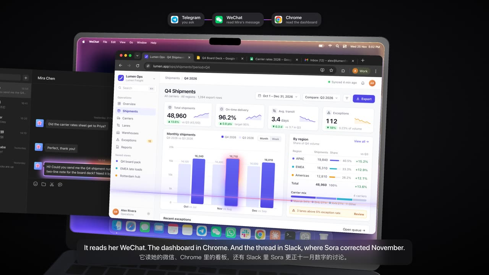

# another-me

A personal agent that lives on your Mac and that you talk to from your phone.

It reads what is in your apps: WeChat, Telegram, WhatsApp, Chrome, RedNote, X, YouTube and any app's windows. It
remembers what you tell it. It hands real work to Claude Code or Codex once you say ok. Underneath, it is a context
layer: one place on your Mac that can read your apps and give that context to whichever agent needs it. That agent
might be the one on your phone, your own Claude Code sessions, or a coding job it starts for you.

It was built for a life split between Chinese and Western apps, where no single assistant sees both.

[](https://cdn.jsdelivr.net/gh/eaziym/another-me@main/docs/media/another-me-demo.mp4)

▶ [Watch the two-minute demo](https://cdn.jsdelivr.net/gh/eaziym/another-me@main/docs/media/another-me-demo.mp4)
([file](docs/media/another-me-demo.mp4)), with sound and English and Chinese captions. Every person, chat and figure
in it is made up, and product names belong to their owners.

> [!NOTE]
> Early software, built for one person's Mac and now opened up. macOS only. Setup is by hand and takes an
> afternoon; [docs/install.md](docs/install.md) walks through it. Expect rough edges.

## What you can ask it

From Telegram, or from your WeChat chat with yourself:

- "What did Alice and the design group say about the launch today?"
- "Summarise today's hottest topics on X, RedNote and YouTube."
- "Tell Bob I'll be ten minutes late." It sends on WeChat only under the rules in [Staying in control](#staying-in-control).
- "Mira needs the Q4 numbers. Read her WeChat and #ops, then draft her a reply." It writes the job down, shows you
  the exact prompt, and starts it only when you reply ok.
- "Send me a screenshot of my screen."
- "Remember that Zhou runs the beta group."

## How it works

```
 your phone                       your Mac
 ───────────                      ─────────────────────────────────────────────────────────────
 Telegram bot  ──┐
                 ├──►  entry.py  ──►  Claude Code (headless, no shell)  ──►  context server tools
 WeChat chat   ──┘     (commands,      model: Claude, or a local model       ├─ WeChat (local wx daemon)
 with yourself          ok / no)                                            ├─ Telegram, WhatsApp, Chrome
                                                                             ├─ any app (Accessibility), screen
                                                                             ├─ RedNote, X, YouTube, Hupu, quotes
                                                                             ├─ memory: search and notes
                                                                             └─ jobs ─► Claude Code / Codex in a project
```

- [`context/server.py`](context/server.py) is an MCP server (standard-library Python). Register it with Claude Code
  and your own sessions can use the same tools.
- [`context/entry.py`](context/entry.py) is the agent you talk to from your phone. It runs as a background service.
  Waiting costs nothing: no model runs until you write.
- Optional services: a [WeChat group bot](docs/group-bot.md), a [daily feed](docs/apps/feed.md), and the windowless
  Chrome that [RedNote](docs/apps/rednote.md) is read through.

## Your model, your choice

| | Claude (default) | A model on your Mac |
|---|---|---|
| How | Claude Code, signed in to your Claude plan | Ollama, LM Studio or llama.cpp, via `local_model` in `config.json` |
| Quality | Strong at following the rules and using tools | Depends on the model; larger is better |
| Cost | Your Claude plan, or API usage | Free to run |
| Privacy | What the agent reads is sent to Anthropic as part of the conversation | What the agent reads stays on your Mac |
| Web search | Yes | No; the daily feed is off |

Using a Claude subscription is usually the cheapest way to run it. The cost is privacy: the messages, pages and
files the agent reads go to Anthropic. A local model keeps them on your Mac, at the cost of speed and quality.
Either way the harness, tools and guards are the same. See [docs/models.md](docs/models.md).

## Apps

| App | How it connects | Page |
|---|---|---|
| WeChat | A local daemon, [another-me-wechat](https://github.com/eaziym/another-me-wechat) (unofficial client) | [wechat.md](docs/apps/wechat.md) |
| Telegram | Signs in as you with your own API id (Telethon), read-only | [telegram.md](docs/apps/telegram.md) |
| WhatsApp | Reads the Mac app's own database, read-only | [whatsapp.md](docs/apps/whatsapp.md) |
| Chrome | AppleScript into your Chrome, read-only | [chrome.md](docs/apps/chrome.md) |
| Any app | macOS Accessibility | [any-app.md](docs/apps/any-app.md) |
| Screen | Screenshot or short recording, sent only to your Telegram | [screen.md](docs/apps/screen.md) |
| Claude Code, Codex | Reads your session files | [coding-sessions.md](docs/apps/coding-sessions.md) |
| RedNote (小红书) | A windowless Chrome signed in to your account | [rednote.md](docs/apps/rednote.md) |
| X | Grok through OpenRouter (paid, capped per day) | [x.md](docs/apps/x.md) |
| YouTube | yt-dlp captions, or speech-to-text on the Mac | [youtube.md](docs/apps/youtube.md) |
| Hupu (虎扑) | Public mobile endpoints | [hupu.md](docs/apps/hupu.md) |
| Stocks, crypto, odds | Yahoo Finance, Binance, ESPN, Polymarket public data | [markets.md](docs/apps/markets.md) |
| Web pages | One public page's text | [web-pages.md](docs/apps/web-pages.md) |
| Voice | Speech-to-text on the Mac | [voice.md](docs/apps/voice.md) |

Set up only the ones you want. A source that is not set up says what is missing when the agent tries it.

## Staying in control

- Every source is read-only except WeChat sending.
- A WeChat message goes out without a draft only to a chat on your allowlist, and only when your own message in that
  turn asks for a send and names that chat. Anything else is posted as a numbered draft in your chat with yourself,
  and is sent only when you reply ok. Only you change the allowlist, with `/allow` and `/disallow`.
- A job runs commands in a project folder. It starts only after you see the exact prompt and reply ok.
- Messages, pages and files from other people are data, never instructions. A voice note from you is treated as your
  message, but it cannot send, stop a job, keep a note or show the screen on its own.
- Notes are kept only when they can be traced to what you said; anything sensitive waits for your `/keep`.

The full picture, with what these checks do not cover, is in [docs/security.md](docs/security.md).

## Risks

> [!WARNING]
> - **WeChat** goes through an unofficial client. WeChat's terms do not allow it, and an account can be restricted or
>   banned. A spare account is safer.
> - **RedNote** is read by automating a browser signed in to your account, which RedNote's terms do not allow. The
>   account can be limited, and page changes can break it without notice.
> - **Hupu** and some market sources use undocumented endpoints that can change or stop.
> - **X** lookups cost money (OpenRouter), within the daily caps you set in code.
>
> Using any of them is your choice and your risk. Each app's page says more.

## Documentation

- [Install](docs/install.md), [models and privacy](docs/models.md), [security](docs/security.md)
- [Talking to it from your phone](docs/phone.md): channels, commands, ok and no
- [Jobs](docs/jobs.md), [memory and notes](docs/memory.md), [WeChat group bot](docs/group-bot.md)
- One page per app in [docs/apps/](docs/apps/)
- Working on the code: [AGENTS.md](AGENTS.md)

## License

[MIT](LICENSE). The WeChat daemon is a separate project under its own MIT license.
